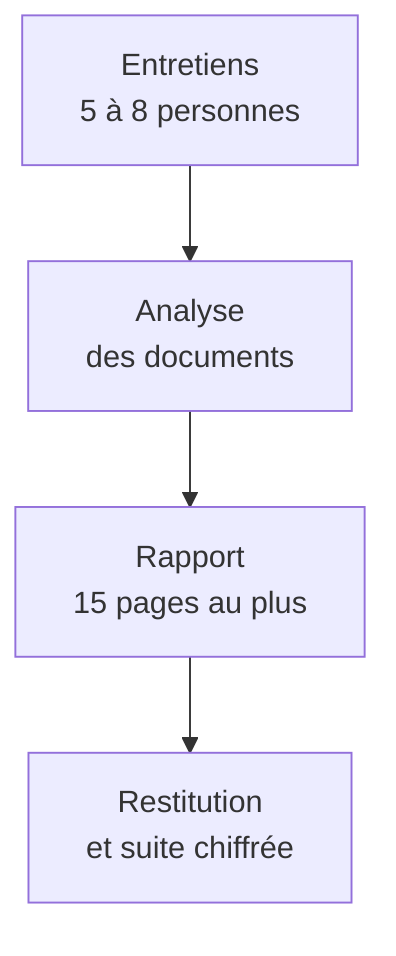

## Le diagnostic répond à un frein commercial identifié

Les prospects hésitent à signer une mission de plusieurs mois sans avoir vu l'équipe travailler. Le diagnostic leur offre une première étape courte, à prix fixe, qui produit un livrable utile même sans suite.

<StatGrid
  items={[
    { value: "2 semaines", label: "de mission" },
    { value: "6 000 €", label: "HT, prix fixe" },
    { value: "40 %", label: "de conversion visée vers une mission longue" },
  ]}
/>

## La mission suit trois temps

### Déroulé du diagnostic

<NumberedCards
  items={[
    { title: "Entretiens", body: "Cinq à huit entretiens d'une heure avec les personnes concernées, de la direction au terrain." },
    { title: "Analyse", body: "Lecture des documents existants et croisement avec les entretiens, pour isoler trois à cinq causes." },
    { title: "Restitution", body: "Un rapport court et une présentation d'une heure, qui se termine par une proposition de suite." },
  ]}
/>

## Les risques restent maîtrisables

<RiskGrid
  items={[
    { title: "Disponibilité du client", body: "Les entretiens se planifient dès la signature, sur la première semaine, pour tenir les deux semaines." },
    { title: "Périmètre qui s'étend", body: "Le contrat fixe le nombre d'entretiens. Au-delà, un avenant s'applique." },
    { title: "Conversion faible", body: "La restitution présente toujours une suite chiffrée, préparée pendant la deuxième semaine." },
  ]}
/>

## Prochaines étapes

<NextStep num={1} title="Validation de la note" desc="Retour du comité de direction avant le 27 janvier." />
<NextStep num={2} title="Contrat type" desc="Rédaction avec le juriste, signature de principe avant le 15 février." />
