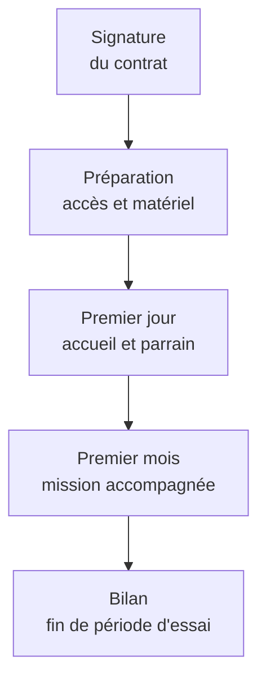

# Arrivée d'un nouveau collaborateur

Processus d'intégration d'une nouvelle personne, de la signature du contrat à la fin de sa période d'essai. Il est porté par la responsable de l'équipe qui recrute, avec l'appui de la direction.

## Étapes

1. **Avant l'arrivée.** La direction commande le matériel et ouvre les accès une semaine avant le premier jour.
2. **Premier jour.** La personne rencontre son parrain, qui l'accompagne pendant le premier mois, et lit ce wiki en commençant par [l'organisation](../organisation/README.md).
3. **Premier mois.** Elle travaille sur une mission en binôme avec son parrain.
4. **Fin de période d'essai.** Un bilan d'une heure avec la responsable d'équipe décide de la suite.

## Points d'attention

- Le parrain appartient à une autre équipe que la personne accueillie, pour qu'elle découvre toute l'entreprise.
